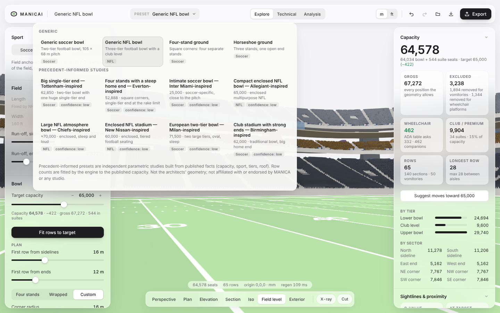

# Manica user guide

Manica generates a stadium from a few rules: a sport, a field, and how the seating bowl should
behave. Every change rebuilds the whole stadium in a fraction of a second, with every seat placed and
every row's sightline solved. This guide covers version 1.0 (Rounds 00–08).

Everything is in millimetres, Z up, with the origin at the centre of the field at field level. +X
runs along the field.

## 1. Start from a preset

Open the **Preset** menu in the toolbar.

- **Generic** presets are clean starting points for soccer and NFL.
- **Precedent-informed studies** take a stadium's published facts (capacity, sport, tiers, roof)
  and fit a Manica bowl to them. They are not the real buildings: row counts are fitted to the
  published capacity, and each preset lists what is published and what Manica assumed under
  **Preset evidence** in the right panel.
- **My presets** are designs you saved in this browser. Type a name under "Save the current
  design" and press **Save as preset**. Hover a saved preset to delete it.

Filter the library by sport with **All · Soccer · NFL**.

## 2. Shape the design (left panel)

Work down the left panel. Each section opens with a summary of its current state.

| Section | What you set |
|---|---|
| Sport, Field | Soccer or NFL, field size and run-off. NFL fields are fixed by Rule 1. |
| Site | Which way the field axis points (N–S, NE–SW, E–W, SE–NW or any bearing), latitude and longitude. This drives the sun study and the exports; it never moves geometry. |
| Bowl | Target capacity, first-row distances, corner radius, and **Fit rows to target**. |
| Tiers | Rows, row depth, seat width, elevation or gap, overhang, C-value target, cross-aisles, vomitories and wheelchair positions per tier. |
| Stands | Each stand or corner on its own: distance, rows per tier, or left open. |
| Seating, Sightlines | Seat and aisle widths, seats between aisles, C-value or fixed-riser mode, maximum rake. |
| Premium, Concourses | Suite and club levels, concourses, program allowances and cores. |
| Roof, Structure, Facade, Back of house | The architecture around the bowl. |
| Field lighting, Boards & broadcast, MEP & service | The technical systems. |

Type into any number to set it exactly. A slider drag is one undo step.

If a change cannot be built, Manica says so and keeps the design as it was.

## 3. Read the results (right panel)

- **Capacity**: net and gross, by tier, sector, stand and class, with the accessible seating count.
  **Suggest moves** proposes changes that close the gap to the target and names any rule they
  would break.
- **Sightlines & proximity**: C-values and distances to the far corner.
- **Checks**: everything the engine flags, such as a low C-value, a headroom clash or a program
  shortfall.
- **Design studies**: view quality, egress, sun, carbon and revenue (section 5).
- **Model check**: 15 checks on the exported model, run on demand.

## 4. Look at it

- **Modes** (top centre): **Explore** for presentation, **Technical** for dimensions, levels, the
  structural grid and floodlight aiming, **Analysis** to colour seats.
- **Views** (bottom bar): perspective, plan, elevation, section, iso, field level and exterior.
  **Cut** adds a live section plane; **X-ray** sees through the roof and facade; **Systems** isolates
  the building systems; **Night** lights the field.
- **Click a seat** to inspect it, then **View from seat**.

## 5. Study and compare

Open **Design studies** in the right panel:

| Study | What it tells you |
|---|---|
| View | A 0–1 view score per seat from distance, sightline and head turn. |
| Egress | Each seat's route to its vomitory or tier exit, and how long each exit takes to clear at Green Guide rates. |
| Sun | Hours of direct sun on the pitch over a day, and how much of the pitch and the seats are in sun at kick-off. |
| Carbon | Material quantities from the model and A1–A3 embodied carbon with generic factors (±30 %). |
| Revenue | Annual gate, club and suite income from the seat mix with your prices. |

**Colour seats by …** puts a study on the bowl. The colours appear a moment after you stop
changing the design.

**Compare** (toolbar, or `O`) puts saved scenarios side by side on every study. **Explore options**
generates about 80 bowls, plots capacity against closeness to the field, and offers a recommended
design and alternatives A–E to apply or save.

These studies are conceptual. They help compare options early on. They are not code compliance,
engineering or a business case. [STUDIES.md](STUDIES.md) states each method and its limits.

## 6. Keep, share and export

- **Autosave.** The open design is saved in this browser as you work and comes back on your next
  visit. Pick a preset to start again.
- **Save** (`⌘S`) downloads a `.manica.json` project file. **Open** reads a project file or a
  Manica `.3dm`. If a file has damaged values, Manica resets them to the defaults and lists them.
- **Share** (link icon) gives a link that carries the whole design in the link itself, about 2 kB.
  Nothing is uploaded. Whoever opens it gets their own copy to change.
- **Export**: Rhino 8 or 7 `.3dm` (with or without seats), IFC 4, glTF, a plan and section DXF,
  quantity, element and seat schedules, the model check report and the design studies report.
  [INTEROP.md](INTEROP.md) covers IFC and Revit.

My presets, scenarios and the autosave live in this browser only. Clearing site data removes them,
so save a project file to keep a design elsewhere.

## 7. Keyboard

| Keys | Does |
|---|---|
| `E` `T` `A` | Explore, Technical, Analysis |
| `1`–`7` | Perspective, plan, elevation, section, iso, field level, exterior |
| `O` | Compare and optimise |
| `⌘Z` / `⇧⌘Z` | Undo / redo |
| `⌘S` | Save the project file |
| `Esc` | Leave seat view, clear the selection, close a menu or sheet |
| `?` | Shortcuts |

## 8. What Manica is not

Manica is an independent experimental tool. It is not an official product of, or endorsed by,
MANICA Architecture or any other studio. It does not use any studio's proprietary methods or
geometry. Its outputs are design-stage studies that need review by qualified professionals before
they are relied on for code compliance, structure, egress or cost.
